<div align="center">

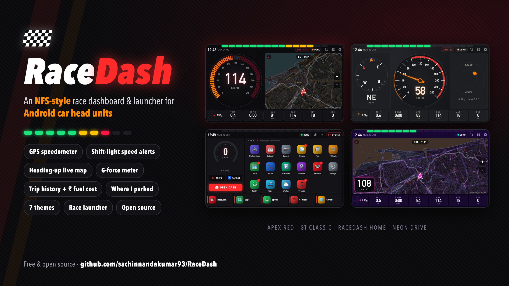

# 🏁 RaceDash

**An NFS-style race dashboard & launcher for Android car head units.**

GPS speedometer · shift-light speed alerts · heading-up live map · G-force meter · trip history with fuel cost · "where I parked" · 7 themes · a race-themed home screen

[**⬇ Download the APK**](../../releases/latest) · [Install guide](#-installation) · [Screenshots](#-screenshots) · [Build from source](#-build-from-source)

</div>

---

## Why I built this

I'm a 90's kid. I grew up on **Need for Speed** — Underground, Most Wanted, Carbon — and the part I loved almost as much as the racing was the dash: the glowing speedo, the shift lights, the minimap spinning with every corner.

Then I got an Android infotainment box for my car, and the home screen was… a grid of icons. Functional, boring.

So I built the dash I always wanted. **RaceDash** turns any Android head unit into something that feels like it came out of a racing game — while still being genuinely useful on a daily drive: real GPS speed, speed-limit warnings, a live map, a log of every trip with what it cost in fuel, and where you left the car.

It's free, open source, needs no account, and your data never leaves the device.

---

## ✨ Features

| | |
|---|---|
| 🏎️ **GPS speedometer** | Smooth needle/segment gauge from the car's GPS — no OBD dongle or wiring needed |
| 🚦 **Shift-light speed alerts** | 15 LEDs fill green → yellow → red as you approach your limit, then flash with a beep when you cross it |
| 🗺️ **Heading-up live map** | OpenStreetMap that rotates with you, auto-zooms with speed and draws your route |
| 🎯 **G-force meter** | Braking, acceleration and cornering forces plus peak G — works however the unit is mounted |
| 🧭 **Compass, trip computer, altitude, odometer** | Trip distance, drive time, average & top speed, sea-level altitude (from the GPS chip) |
| 📒 **Trip history** | Every drive recorded automatically in the background — even when another app is on screen |
| ⛽ **Fuel cost** | Each trip's litres and ₹ cost from your mileage and fuel price; 7-day totals |
| 🅿️ **Where I parked** | Last trip's end point, how long ago, and how far / which way it is |
| 🎨 **7 themes** | Apex Red · Neon Drive · GT Classic · Volt EV · Toxic · Daylight · Night Stealth |
| 🌙 **Auto night mode** | Switches to low-glare Night Stealth by clock (7 pm–6 am) or light sensor |
| 🧩 **3 layouts** | Race (gauge + map) · Gauge (big gauge + compass + G-meter) · Map (full map) |
| 🏠 **RaceDash Home launcher** | Race-themed home screen with live speed ring, all your apps, a pinnable dock and a one-tap **SYSTEM** exit |
| 🪶 **Light on old hardware** | Idles when parked, built for slow 2–4 GB head units with old WebView versions |

---

## 📸 Screenshots

| Race layout — Apex Red | Gauge layout — GT Classic |
|---|---|
| 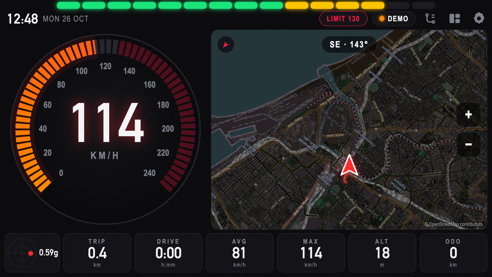 | 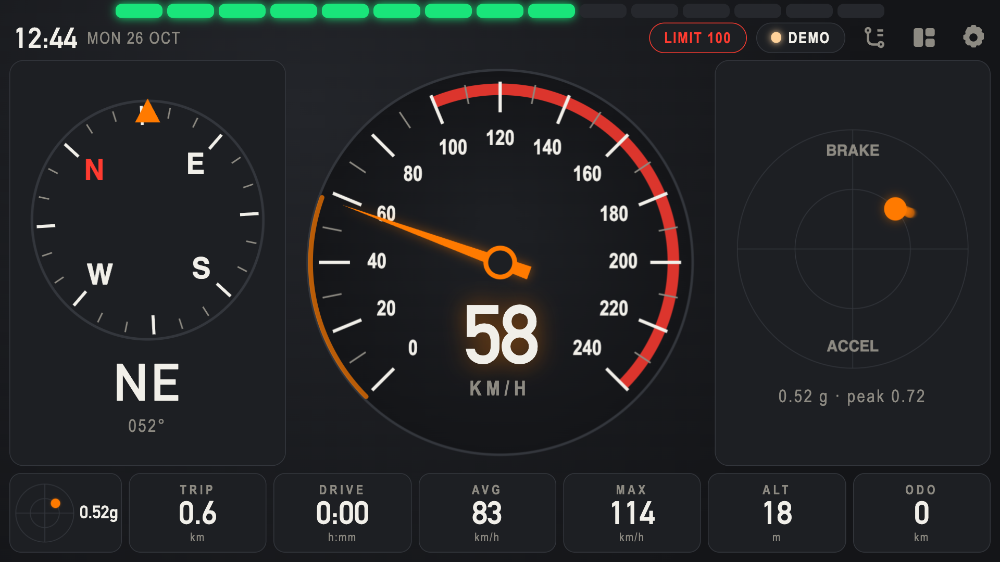 |
| **Map layout — Neon Drive** | **Over the limit — Volt EV** |
| 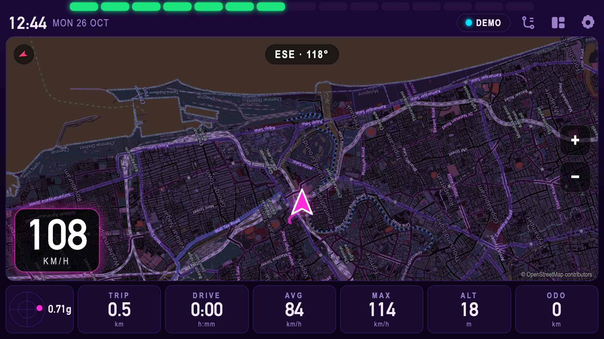 | 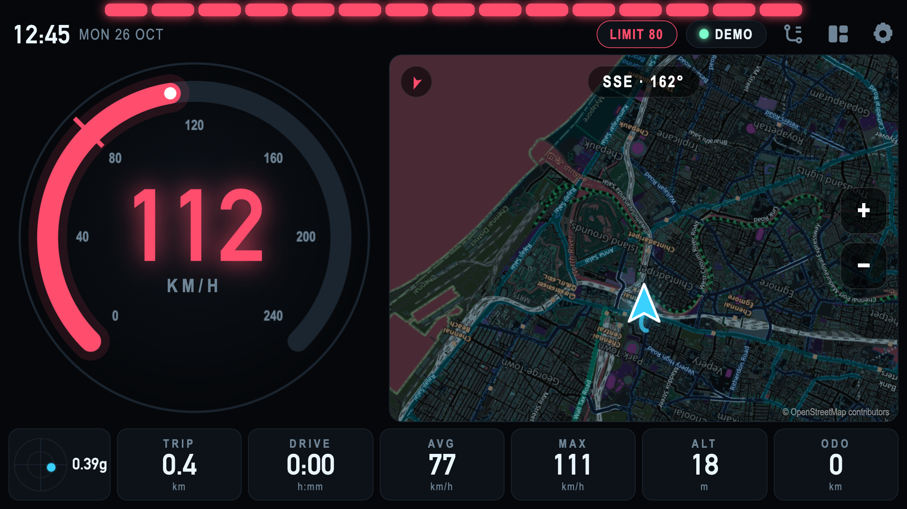 |
| **Toxic** | **Night Stealth** |
| 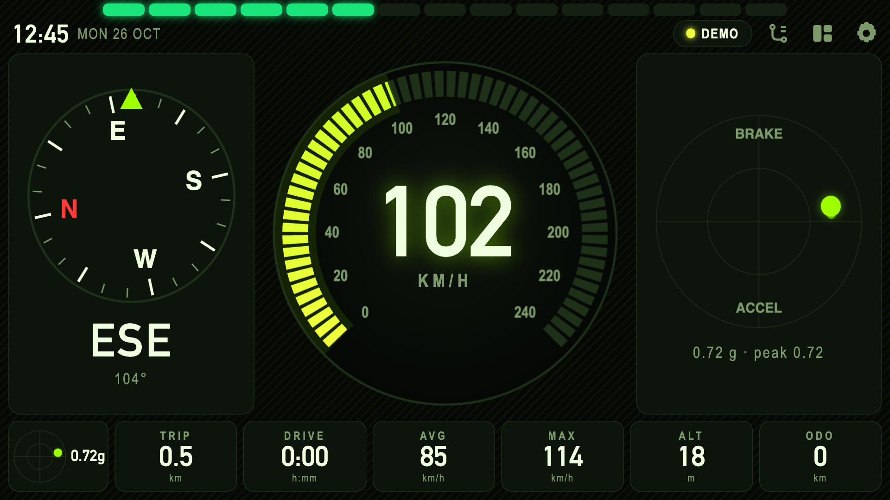 | 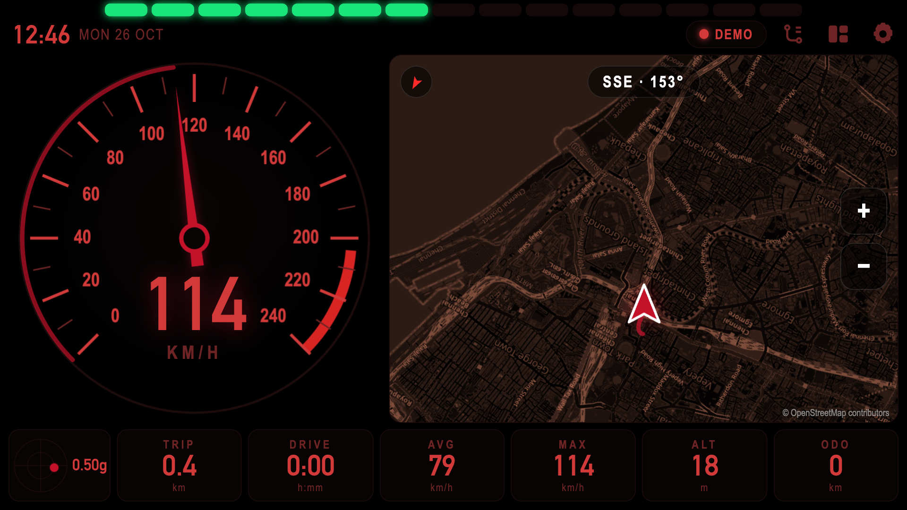 |
| **RaceDash Home launcher** | **Trip history + fuel cost** |
| 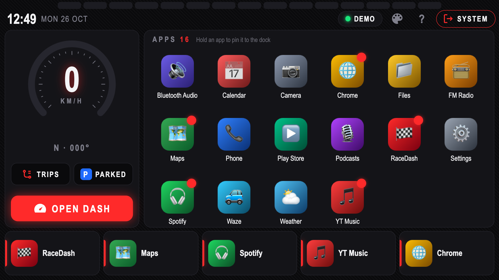 | 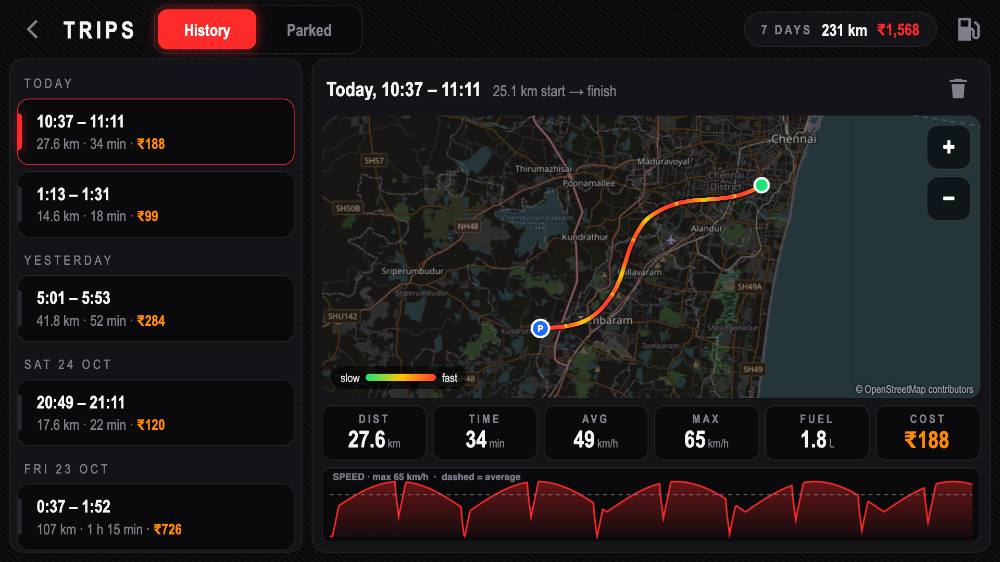 |
| **Themes & settings** | **Where I parked** |
| 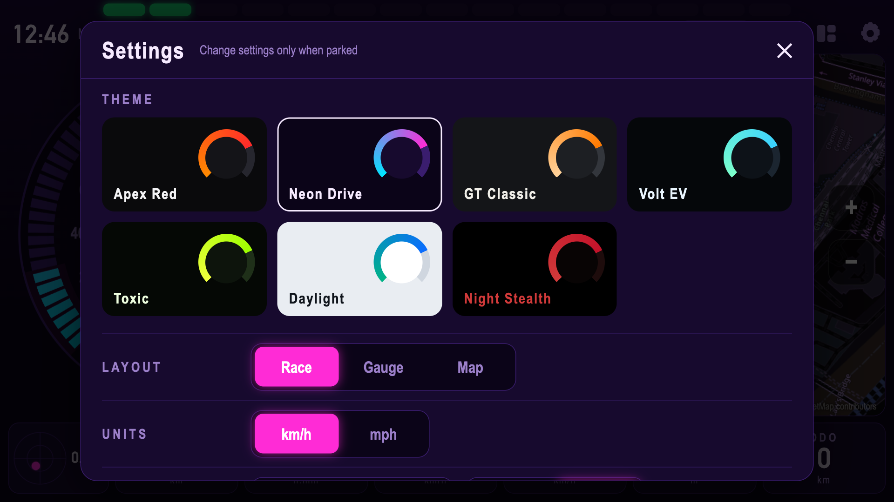 | 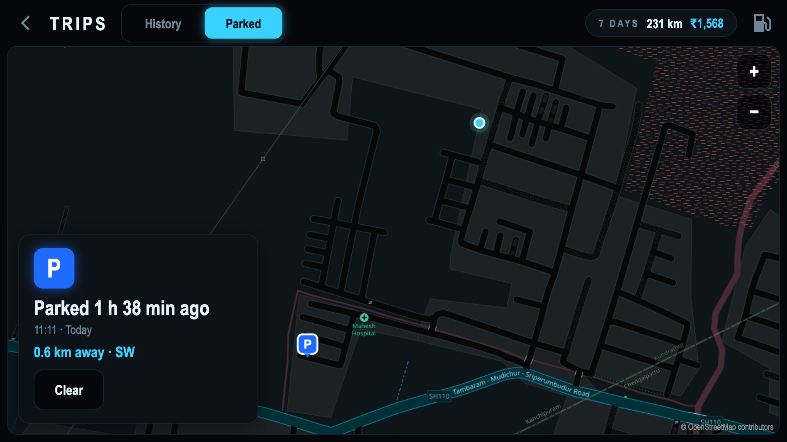 |

<sub>Screenshots use the built-in **Demo drive** (simulated GPS) so no real location data is shown.</sub>

---

## ✅ Compatibility

RaceDash works on most **Android-based car head units, CarPlay/Android Auto "AI boxes" and Android tablets** used as a car display.

| Requirement | |
|---|---|
| Android version | **7.0 or newer** (Android 10–13 recommended) |
| Screen | Landscape; tested at 744×480, 1024×600, 1280×720 and 1920×720 ultrawide |
| GPS | Built-in GPS (most head units have one). Without GPS the dash still runs in Demo mode |
| Internet | Only for map tiles (phone hotspot / Wi-Fi / SIM). Speedo, G-meter and trips work offline. Viewed map areas are cached |
| Storage | < 100 KB app + ~40 KB per hour of driving |

> It's a standard APK — no root, no system changes, and it never replaces your launcher unless **you** choose to.

---

## 📥 Installation

### 1. Download

Get **`RaceDash-v1.0.0.apk`** from the [**Releases page**](../../releases/latest).

### 2. Get it onto the head unit — pick one

<details open>
<summary><b>Option A — USB stick (easiest, works on almost every unit)</b></summary>

1. Copy `RaceDash-v1.0.0.apk` to a USB pen drive (or SD card).
2. Plug it into the head unit.
3. Open the unit's **File Manager** / **Files** / **ES File Explorer** app and tap the APK.
4. If asked *"For your security, your phone is not allowed to install unknown apps from this source"*, tap **Settings** → enable **Allow from this source** → go back → **Install**.

</details>

<details>
<summary><b>Option B — Download directly on the head unit</b></summary>

1. On the head unit, open **Chrome** (or the built-in browser) and go to this repo's **Releases** page.
2. Tap `RaceDash-v1.0.0.apk` to download it.
3. Open it from the download notification or the **Downloads** folder and tap **Install** (allow "unknown apps" for the browser if asked).

</details>

<details>
<summary><b>Option C — Wireless ADB from a computer (for tinkerers)</b></summary>

1. On the head unit: **Settings → About** → tap **Build number** 7 times to unlock **Developer options**.
2. **Developer options → Wireless debugging → On** → **Pair device with pairing code**.
3. On your computer (with [Android platform-tools](https://developer.android.com/tools/releases/platform-tools)):

   ```bash
   adb pair <ip>:<pairing-port> <6-digit-code>
   adb connect <ip>:<port-shown-on-wireless-debugging-screen>
   adb install RaceDash-v1.0.0.apk
   ```

   Older units (Android ≤ 10) usually use `adb connect <ip>:5555` after enabling **USB/Network debugging** instead of pairing.

</details>

> **Play Protect warning?** Some units show *"Unsafe app blocked"* or *"Unknown app"* for any APK not from the Play Store. Tap **More details → Install anyway**. RaceDash is open source — you can read every line in this repo.

### 3. First launch

1. Open **RaceDash** from your app list.
2. When asked for **location**, choose **While using the app**. (For trip recording while *other* apps are on screen, also allow **"Allow all the time"** in **Settings → Apps → RaceDash → Permissions → Location**.)
3. Allow **notifications** if asked — the trip recorder shows a small, silent "RaceDash trips" notification while it runs.
4. Wait for the GPS badge (top-right) to turn green with a satellite count. Done — go for a drive. 🏁

### 4. (Optional) Make RaceDash Home your home screen

1. Open **RaceDash Home** from your app list to try it like a normal app.
2. To make it your home screen, press the **Home** button → choose **RaceDash Home** → **Always** (or **Just once** to test).
3. **To get out at any time**, tap **SYSTEM** (top-right) — it jumps straight to your original launcher.
4. **To go back permanently**: on RaceDash Home tap **?** → **Choose default launcher…** → pick your original launcher. (Or **Settings → Apps → Default apps → Home app**.)

> ⚠️ Some head units use a custom launcher that also handles things like reverse camera or steering-wheel controls. If anything stops working with RaceDash Home as default, switch back with step 4 — the RaceDash dash app itself never interferes with these.

### 5. Recommended setup

- **Trips → ⛽ (fuel icon)**: set your car's **mileage (km/l)** and **fuel price (₹/l)** so trip costs are accurate.
- **Dash → ⚙ Settings**: pick a theme, set a **speed alert**, and turn on **Night mode → 7 pm – 6 am**.
- **Long-press TRIP** on the dash to reset the trip computer.

---

## 🛠 Troubleshooting

| Problem | Fix |
|---|---|
| Speed stays at 0 / "NO GPS" | Give it a minute under open sky. Check **Settings → Location** is on. Indoors/garages block GPS |
| Map is blank | Map tiles need internet — connect the unit to Wi-Fi or your phone's hotspot |
| Trips aren't recorded when using other apps | Allow location **"Allow all the time"** (see First launch). Some units have an **auto-start / background app manager** — whitelist RaceDash there |
| Trips don't start after the car is switched on | Some units block apps from starting at boot. Open RaceDash once after starting the car, or whitelist it in the unit's auto-start manager |
| App looks slow | Close heavy background apps (video streaming). If your unit lets you, updating **Android System WebView** from the Play Store helps a lot on older units |
| Want the old launcher back | Tap **SYSTEM** on RaceDash Home, or **? → Choose default launcher…** |

---

## 🔒 Privacy

- **No accounts, no analytics, no ads, no tracking.**
- GPS data, trips and settings are stored **only on the head unit** (app-private storage). Uninstalling the app deletes them.
- The only network requests are **map tiles** from OpenStreetMap.
- Permissions used: location (speed, map, trips), internet (map tiles), foreground service + boot (background trip recorder), notifications (recorder status).

## 🚗 Drive safely

RaceDash is a display, not a racing licence. 😄 Set it up and change settings **while parked**, keep your eyes on the road, and follow local speed limits. The speed shown is GPS-derived and may differ slightly from your car's speedometer.

---

## 🏗 How it's built

A small native Android shell (Java) hosting a fast HTML5/Canvas UI:

```
app/src/main/
├── java/com/racedash/app/
│   ├── MainActivity.java    # Dash: fullscreen WebView + GPS/gyro/NMEA → JS bridge, OSM tile cache
│   ├── HomeActivity.java    # RaceDash Home launcher (app list, icons, launch, SYSTEM exit)
│   ├── TripsActivity.java   # Trip history / parked screen
│   ├── TripService.java     # Foreground service: records drives in the background
│   ├── TripStore.java       # Crash-safe JSON trip log (atomic writes, power-cut recovery)
│   └── BootReceiver.java    # Starts the recorder when the unit powers on
└── assets/dash/
    ├── index.html · app.js · style.css    # The dashboard (gauges, map, G-meter, settings)
    ├── home.html · home.js · home.css     # The launcher
    ├── trips.html · trips.js · trips.css  # Trips, fuel cost, parked
    └── themes.js                          # The 7 shared themes
```

Highlights: G-force uses gyro yaw rate projected onto gravity × GPS speed, so it works **regardless of how the unit is mounted**; altitude comes from the GPS chip's NMEA `GGA` sentence (true sea level); rendering idles when nothing changes to keep old head units cool.

### 🔧 Build from source

Requirements: JDK 17 and the Android SDK (platform 35).

```bash
git clone https://github.com/sachinnandakumar93/RaceDash.git
cd RaceDash
echo "sdk.dir=/path/to/Android/sdk" > local.properties
./gradlew assembleRelease
# → app/build/outputs/apk/release/app-release.apk
```

Without a signing config the release build is signed with your debug key — fine for personal use.

You can also preview the UI in a desktop browser (it runs on a simulated drive):

```bash
python3 -m http.server 8765 --directory app/src/main/assets/dash
# open http://localhost:8765/  ·  /home.html  ·  /trips.html
```

---

## 🗺 Roadmap ideas

- OBD-II (ELM327 Bluetooth) for real RPM, coolant temp and fuel level → true shift lights
- Now-playing music card with big controls
- GPX / CSV trip export
- Lap timer / track mode (for track days only!)

Contributions and ideas welcome — open an issue or PR.

## 🙏 Credits

- Map data © [OpenStreetMap](https://www.openstreetmap.org/copyright) contributors
- Inspired by every racing game HUD that made a 90's kid want a cooler car

## 📄 License

[MIT](LICENSE) © 2026 Sachin Nandakumar
